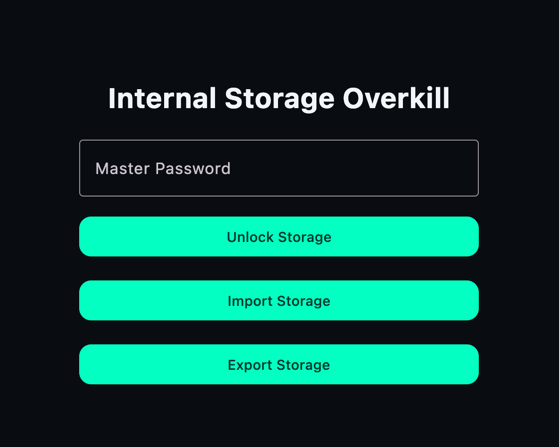
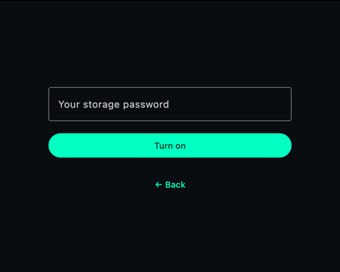
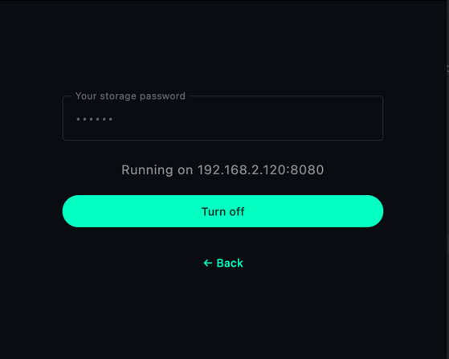
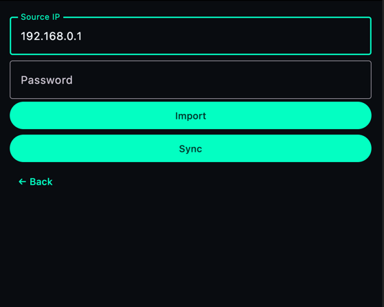
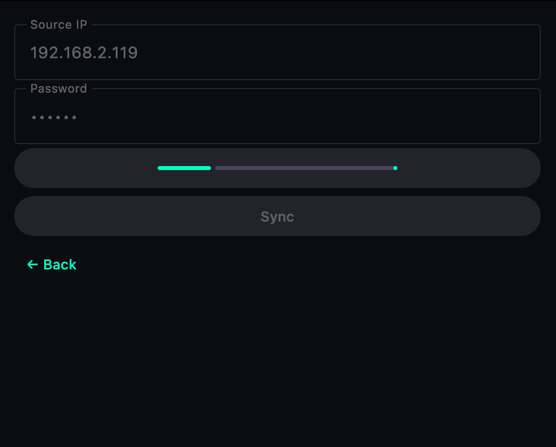
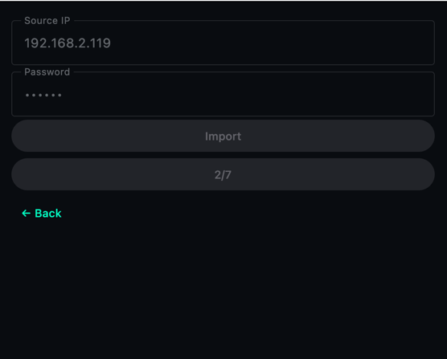

# InternalStorageOverkill

## Overview
Intrakill is a sqlite encrypted media storage. It's obviously an overkill and I named it after that.  
Still, if you always wanted a personal media storage that primarily allows to conveniently navigate
through grouped media attachments, this might be it. It shines with manga and comics.  
The storage consists of list of entries. Each entry contains a name, attachments and tags.  
DISCLAIMER: I'm a simple man, and I'm terrible at UI&UX. Therefore, it's anything but fancy. Be warned.

### Login scene  



Main scene. On first run it will accept any (valid) password, which then will be used for all further manipulations.  
If you forget the password, there is nothing you can do, but deleting the storage and creating it anew.  
You can try to bruteforce it. I don't mind.  


### Export storage

It's the other half of import/export process.  
Once you enter your password and hit "Turn on", it exposes http server on your local network and uses your master password  
both for authorization and accessing your storage to share the data.
It intentionally does not run in the background on android devices.






### Import storage

It's convenient to be able to share the storage between your devices.  
You can export a storage from one device and import it on another.  
It MUST happen within the same local network.  
Importing device MUST know the password from exporting device.  
The password will be used to access the storage once import is complete.  
Those are the rules.  
You can see the ip address on the exporter device once it's active. You only need the IP (ignore the port).
You can change the password in the application settings at any time. 

> **WARNING**: your existing storage will be replaced with the imported one.





There is also a synchronization feature.  
It computes entry-level difference and copies missing entries from the exporter to a syncing device.  
Convenient when you don't want to transfer huge storages back and forth.  




### Sharing

This one is to share entries individually with android devices.  
Every entry has a share button which creates QR code and runs http server for that sole entry ONLY.  
To receive the entry one must open their storage, open "Add entry" scene and press QR scan button there.  
Once it scans the screen of the sharing device, it basically creates a copy of that entry in your storage.  
Closing QR code will immediately stop the server and thus sharing.  
Sharing does not require devices to have the same password. It doesn't share one too. 
> QR code contains the ip address, shared entry id and a random-generated integer on each sharing attempt.  

### Copy attachment

This one is unintuitive. Pressing an attachment under entry scene for a short duration copies it to your clipboard.  
You will see a notification about it at the bottom of the screen.  
You must be able to paste it normally in other applications after that.


## Questions and Answers

Q: Where is iOS support?  
A: I don't have practical reasons to implement iOS version since I don't have a device nor intent to test emulators.

Q: Is it possible to store files other than images?  
A: It's a media storage and is 99% intended for images and video.

Q: How do I reset password?
A: You can't. Once you forget it, the storage is lost.`*`
> Technically, you can bruteforce it, but that depends on how strong your password was.  
> i.e. 6-8 char password containing only digits will take approx a minute to brute.  
> 6-8 char password containing symbols+letters+digits might take years.

Q: Okay, I forgot the password. How do I delete db and create new?  
A: Well, I guess, at that point I'd just reinstall the app, but I didn't put dedicated feature to create storage anew.
To delete storage on desktop see [Where is the storage](#Desktop)


## Technical

It's a kotlin multiplatform application and supports jvm desktop and android. I have no reason to mess with iOS for now.  
Implementation was heavily influenced with claude, chatgpt and gemini. KMP by 02.2026 has a very rough learning curve compared to 
my previous experience with flutter and even reactjs. I had to interrogate AI on many design solutions, and some of them still don't feel right.  
Then I bumped into [Decompose](https://github.com/arkivanov/Decompose).  
For someone with a backend background it's a breath of fresh air.  
Now, there still are some edgecases, but I can't stress enough how good that library is.

### Where is the storage

#### Desktop

Under `System.getProperty("user.home")/.Intrakill/databases/secured.db`.  
On Unix that'd be `~/.Intrakill/databases`, on Windows, I assume, it has to be `c:\Users\%username%\.Intrakill\databases\secured.db`.  

#### Android

On Android it goes under `context.getDatabasePath("secured.db")`, so it's up to android OS to decide where the file is  
stored. Basically, it means, file will end up in the system folder designated for the app.  
In any case, it's sqlcipher database file, so you have little to nothing to worry about.

### Build and Run Android Application

To build and run the development version of the Android app, use the run configuration from the run widget
in your IDE’s toolbar or build it directly from the terminal:

- on macOS/Linux
  ```shell
  ./gradlew :composeApp:assembleDebug
  ```
- on Windows
  ```shell
  .\gradlew.bat :composeApp:assembleDebug
  ```

### Build and Run Desktop (JVM) Application

To build and run the development version of the desktop app, use the run configuration from the run widget
in your IDE’s toolbar or run it directly from the terminal:

- on macOS/Linux
  ```shell
  ./gradlew :composeApp:run
  ```
- on Windows
  ```shell
  .\gradlew.bat :composeApp:run
  ```

### Contributions

Contributions of any sort are welcome.  
If you know how to improve the app or provide better UX, open an issue or a pull request.  